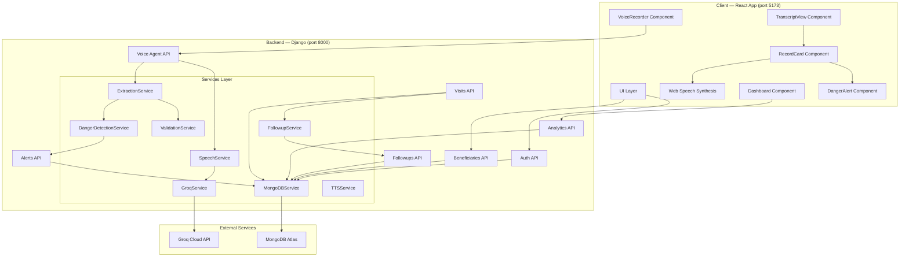
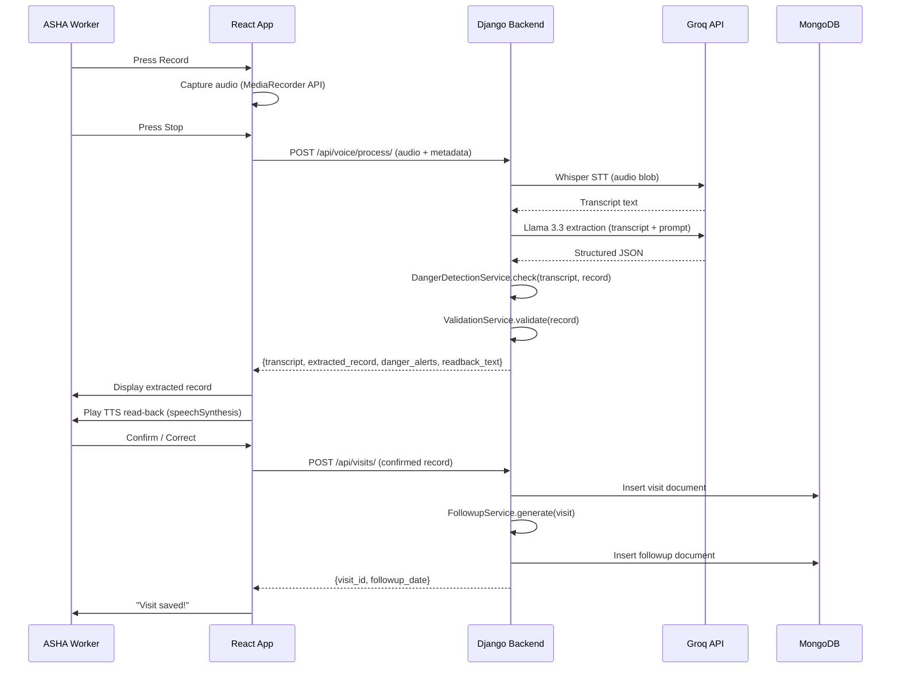
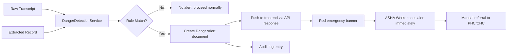

# ASHA Voice — Technical Architecture

> Detailed system design for the AI-powered multilingual healthcare voice assistant

---

## Table of Contents

1. [System Overview](#1-system-overview)
2. [Component Interaction Diagram](#2-component-interaction-diagram)
3. [Data Flow Diagram](#3-data-flow-diagram)
4. [Database Schema](#4-database-schema)
5. [API Endpoint Reference](#5-api-endpoint-reference)
6. [Speech Provider Abstraction](#6-speech-provider-abstraction)
7. [Danger Sign Engine](#7-danger-sign-engine)
8. [Security Model](#8-security-model)
9. [Scalability Notes](#9-scalability-notes)

---

## 1. System Overview

ASHA Voice is a three-tier web application:

| Tier | Technology | Responsibility |
|---|---|---|
| **Presentation** | React 18 + TypeScript + Vite | Mobile-first UI, voice capture, TTS read-back |
| **Application** | Django 4.2 + DRF + Channels | REST API, WebSocket, business logic, AI orchestration |
| **Data** | MongoDB Atlas | Persistent document storage |

External services:
- **Groq Cloud** — Whisper STT + Llama 3.3 70B inference
- **Browser Web Speech API** — TTS read-back (client-side, no network)
- **Gnani API** *(planned)* — Streaming STT/TTS adapter

---

## 2. Component Interaction Diagram



---

## 3. Data Flow Diagram

### Voice Recording Pipeline



### Danger Sign Alert Flow



---

## 4. Database Schema

All collections are stored in MongoDB Atlas, database name: `asha_voice`.

### `users` collection

```json
{
  "_id": "ASHA001",
  "name": "Meena Devi",
  "phone": "9876543210",
  "district": "Coimbatore",
  "sub_district": "Sulur",
  "assigned_village": "Sulur Main",
  "password_hash": "<bcrypt hash>",
  "role": "asha_worker",
  "is_active": true,
  "created_at": "2024-01-01T00:00:00Z",
  "last_login": "2024-11-15T10:30:00Z"
}
```

**Indexes:** `_id` (unique), `district`

---

### `beneficiaries` collection

```json
{
  "_id": "BEN001",
  "name": "Lakshmi",
  "age": 24,
  "village": "Sulur",
  "district": "Coimbatore",
  "phone": "9876543210",
  "asha_worker_id": "ASHA001",
  "category": "pregnant",
  "pregnancy_month": 7,
  "lmp_date": "2024-04-01",
  "edd": "2025-01-08",
  "husband_name": "Rajan",
  "address": "12 Main Street, Sulur",
  "is_active": true,
  "created_at": "2024-04-15T00:00:00Z",
  "updated_at": "2024-11-15T10:00:00Z"
}
```

**Indexes:** `_id` (unique), `asha_worker_id`, `category`

---

### `visits` collection

```json
{
  "_id": "VIS20241115001",
  "beneficiary_id": "BEN001",
  "asha_worker_id": "ASHA001",
  "visit_type": "pregnancy",
  "visit_date": "2024-11-15",
  "pregnancy_month": 7,
  "weight_kg": 2.8,
  "bp_systolic": null,
  "bp_diastolic": null,
  "anc_completed": true,
  "ifa_given": true,
  "tt_given": false,
  "next_visit_date": "2024-12-02",
  "danger_signs": [],
  "notes": "Routine 7-month ANC visit.",
  "transcript": "Innikki Lakshmi veetukku ponen...",
  "audio_session_id": "SES001",
  "confirmed_at": "2024-11-15T11:05:00Z",
  "created_at": "2024-11-15T11:00:00Z",
  "schema_version": "1.0"
}
```

**Indexes:** `beneficiary_id`, `asha_worker_id`, `visit_date`, `visit_type`

---

### `danger_alerts` collection

```json
{
  "_id": "ALT001",
  "visit_id": "VIS20241115001",
  "beneficiary_id": "BEN001",
  "asha_worker_id": "ASHA001",
  "danger_sign_code": "DS001",
  "danger_sign_name": "Bleeding during pregnancy",
  "trigger_text": "pregnant woman is experiencing bleeding",
  "source": "transcript",
  "severity": "critical",
  "action_required": "Refer immediately to nearest PHC/CHC. Call 108 emergency services.",
  "protocol_source": "WHO Pregnancy, Childbirth, Postpartum and Newborn Care Guide, 2015, Section C1",
  "is_resolved": false,
  "resolved_by": null,
  "resolved_at": null,
  "created_at": "2024-11-15T11:01:00Z"
}
```

**Indexes:** `beneficiary_id`, `asha_worker_id`, `is_resolved`, `created_at`

---

### `followups` collection

```json
{
  "_id": "FUP001",
  "beneficiary_id": "BEN001",
  "asha_worker_id": "ASHA001",
  "source_visit_id": "VIS20241115001",
  "followup_type": "anc_visit",
  "due_date": "2024-12-02",
  "priority": "normal",
  "notes": "8-month ANC visit. Check weight, BP, fetal movement.",
  "is_completed": false,
  "completed_at": null,
  "created_at": "2024-11-15T11:05:00Z"
}
```

**Indexes:** `beneficiary_id`, `asha_worker_id`, `due_date`, `is_completed`

---

### `voice_sessions` collection

```json
{
  "_id": "SES001",
  "asha_worker_id": "ASHA001",
  "beneficiary_id": "BEN001",
  "language": "tamil",
  "audio_duration_seconds": 12.4,
  "transcript": "Innikki Lakshmi veetukku ponen...",
  "extraction_model": "llama-3.3-70b-versatile",
  "extraction_prompt_version": "v1.2",
  "extraction_response_raw": "{...}",
  "danger_check_ran": true,
  "danger_signs_found": [],
  "status": "confirmed",
  "created_at": "2024-11-15T11:00:00Z",
  "confirmed_at": "2024-11-15T11:05:00Z"
}
```

**Indexes:** `asha_worker_id`, `created_at`, `status`

---

### `audit_logs` collection

```json
{
  "_id": "AUD001",
  "actor_id": "ASHA001",
  "action": "visit_confirmed",
  "resource_type": "visit",
  "resource_id": "VIS20241115001",
  "ip_address": "192.168.1.1",
  "user_agent": "Mozilla/5.0...",
  "timestamp": "2024-11-15T11:05:00Z",
  "metadata": {
    "danger_alerts_created": 0,
    "followups_created": 1
  }
}
```

**Indexes:** `actor_id`, `timestamp`, `action`

---

## 5. API Endpoint Reference

### Base URL
`http://localhost:8000/api/`

### Authentication Endpoints

| Method | Path | Auth Required | Description |
|---|---|---|---|
| POST | `/auth/login/` | No | Returns session token |
| POST | `/auth/logout/` | Yes | Invalidates token |
| GET | `/auth/me/` | Yes | Current worker profile |

### Beneficiary Endpoints

| Method | Path | Auth Required | Description |
|---|---|---|---|
| GET | `/beneficiaries/` | Yes | List worker's beneficiaries |
| POST | `/beneficiaries/` | Yes | Create beneficiary |
| GET | `/beneficiaries/{id}/` | Yes | Get beneficiary detail |
| PATCH | `/beneficiaries/{id}/` | Yes | Update beneficiary |

### Voice & Visit Endpoints

| Method | Path | Auth Required | Description |
|---|---|---|---|
| POST | `/voice/transcribe/` | Yes | Audio → transcript only |
| POST | `/voice/extract/` | Yes | Transcript → structured record |
| POST | `/voice/process/` | Yes | Full pipeline (preferred) |
| POST | `/visits/` | Yes | Save confirmed visit |
| GET | `/visits/` | Yes | List visits (paginated) |
| GET | `/visits/{id}/` | Yes | Get single visit |
| GET | `/visits/beneficiary/{ben_id}/` | Yes | All visits for beneficiary |

### Danger Alert Endpoints

| Method | Path | Auth Required | Description |
|---|---|---|---|
| GET | `/danger-alerts/` | Yes | Active alerts for worker |
| GET | `/danger-alerts/{id}/` | Yes | Single alert detail |
| PATCH | `/danger-alerts/{id}/resolve/` | Yes | Mark alert resolved |

### Follow-up Endpoints

| Method | Path | Auth Required | Description |
|---|---|---|---|
| GET | `/followups/` | Yes | Upcoming follow-ups |
| GET | `/followups/overdue/` | Yes | Past-due follow-ups |
| PATCH | `/followups/{id}/complete/` | Yes | Mark follow-up done |

### Analytics Endpoints

| Method | Path | Auth Required | Description |
|---|---|---|---|
| GET | `/analytics/summary/` | Yes | Counts: visits, pregnancies, alerts |
| GET | `/analytics/visits-by-week/` | Yes | Weekly visit trend (8 weeks) |
| GET | `/analytics/danger-sign-breakdown/` | Yes | Alert counts by danger sign code |
| GET | `/analytics/follow-ups-due/` | Yes | Follow-up status breakdown |

---

## 6. Speech Provider Abstraction

The `SpeechService` class acts as a provider-agnostic interface for STT:

```python
class SpeechProvider(ABC):
    @abstractmethod
    def transcribe(self, audio_bytes: bytes, language: str, mime_type: str) -> str:
        """Transcribe audio bytes to text."""
        ...

class GroqSpeechProvider(SpeechProvider):
    """Chunked upload to Groq Whisper Large v3."""
    def transcribe(self, audio_bytes, language, mime_type):
        # Upload to Groq Whisper endpoint
        ...

class GnaniSpeechProvider(SpeechProvider):
    """Streaming adapter for Gnani STT/TTS (requires credentials)."""
    def transcribe(self, audio_bytes, language, mime_type):
        # Gnani streaming API — not yet live
        raise NotImplementedError("Gnani credentials required")

class SpeechService:
    def get_provider(self, provider_name: str) -> SpeechProvider:
        providers = {
            'groq': GroqSpeechProvider(),
            'gnani': GnaniSpeechProvider(),
        }
        return providers.get(provider_name, GroqSpeechProvider())
```

**Switching providers:** Set `SPEECH_PROVIDER=gnani` in `.env` and provide `GNANI_API_KEY`.

**TTS:** Read-back text is returned in the API response as `readback_text`. The frontend uses `window.speechSynthesis` with `lang='ta-IN'` for Tamil and `lang='en-IN'` for English.

---

## 7. Danger Sign Engine

### Design Principles

The `DangerDetectionService` is intentionally **not AI-based**:

1. **Determinism** — Given the same input, it always produces the same output
2. **Independence** — It runs even if Groq is unavailable
3. **Dual scanning** — Scans both the raw transcript AND the AI-extracted record fields
4. **No false negatives by construction** — Rules use broad keyword sets; false positives are acceptable, false negatives are not

### Rule Structure

```python
@dataclass
class DangerSignRule:
    code: str
    name: str
    keywords: List[str]          # English and transliterated Tamil keywords
    severity: str                # 'critical' | 'high' | 'medium'
    action_required: str
    protocol_source: str

DANGER_SIGN_RULES: List[DangerSignRule] = [
    DangerSignRule(
        code="DS001",
        name="Bleeding during pregnancy",
        keywords=["bleeding", "hemorrhage", "blood loss", "bleeding aagirukkaa",
                  "ரத்தப்போக்கு", "bleed"],
        severity="critical",
        action_required="Refer immediately to nearest PHC/CHC. Call 108 emergency services.",
        protocol_source="WHO Pregnancy, Childbirth, Postpartum and Newborn Care Guide, 2015, Section C1"
    ),
    # ... DS002–DS008
]
```

### Detection Algorithm

```python
def check(self, transcript: str, extracted_record: dict) -> List[DangerAlert]:
    alerts = []
    text_to_scan = [
        transcript.lower(),
        json.dumps(extracted_record).lower()
    ]
    for rule in DANGER_SIGN_RULES:
        for text in text_to_scan:
            if any(keyword.lower() in text for keyword in rule.keywords):
                alerts.append(self._build_alert(rule, transcript))
                break  # Don't double-count the same rule
    return alerts
```

### Determinism Guarantee

- No LLM calls inside the danger detection path
- No network I/O inside the danger detection path
- Keywords are stored as a static Python list (not fetched from DB)
- The function is pure: same inputs → same outputs, always

---

## 8. Security Model

### Authentication
- Session token stored server-side in `users` collection
- Token included in `Authorization: Token <value>` header
- Demo: tokens do not expire (production requires TTL + refresh)

### Secret Management
| Secret | Storage | Committed? |
|---|---|---|
| `GROQ_API_KEY` | `backend/.env` | ❌ Never |
| `MONGODB_URI` | `backend/.env` | ❌ Never |
| `DJANGO_SECRET_KEY` | `backend/.env` | ❌ Never |
| `.env.example` | Repo root | ✅ Safe (placeholder values only) |

### Data Handling
- Transcripts are stored only in `voice_sessions` during the confirmation window
- After visit confirmation, `voice_sessions.transcript` is retained for audit
- Audio bytes are **never stored** — only processed in memory and discarded
- All MongoDB collections have field-level write validation via Pydantic before insert

### CORS
- `CORS_ALLOWED_ORIGINS` is read from `.env`
- Default: `http://localhost:5173,http://127.0.0.1:5173`
- Never use `CORS_ALLOW_ALL_ORIGINS=True` in production

### Input Validation
- All API inputs validated via DRF serializers + Pydantic schemas
- Audio upload capped at 25 MB (Groq Whisper limit)
- SQL injection not applicable (MongoDB); NoSQL injection prevented by using PyMongo's parameterized queries (never string interpolation)

---

## 9. Scalability Notes

| Concern | Current (Demo) | Production Path |
|---|---|---|
| **Database** | MongoDB Atlas Free Tier (512 MB) | M10+ cluster with sharding on `asha_worker_id` |
| **AI inference** | Groq shared API | Groq dedicated instances or self-hosted Llama |
| **Audio processing** | Synchronous in request thread | Celery task queue + Redis broker |
| **WebSocket** | Django Channels InMemoryChannelLayer | Redis channel layer for multi-process |
| **Authentication** | Session tokens | JWT with short TTL + refresh tokens |
| **Deployment** | docker-compose (single host) | Kubernetes cluster, GKE or EKS |
| **STT** | Groq Whisper chunked upload | Gnani streaming for real-time transcription |
| **Offline support** | Not implemented | Service worker + IndexedDB sync queue |

### Horizontal Scaling Bottlenecks

1. **MongoDB connection pool** — PyMongo singleton handles this per process; Kubernetes pods each maintain their own pool (fine for MongoDB Atlas)
2. **Groq rate limits** — Groq Free Tier: 30 req/min, 14,400 req/day. For 100 concurrent ASHA workers, a request queue is required
3. **Audio upload size** — Each voice recording averages 500 KB–2 MB. With 1,000 daily visits, bandwidth is negligible. At 100,000 visits/day, CDN upload endpoints are recommended
